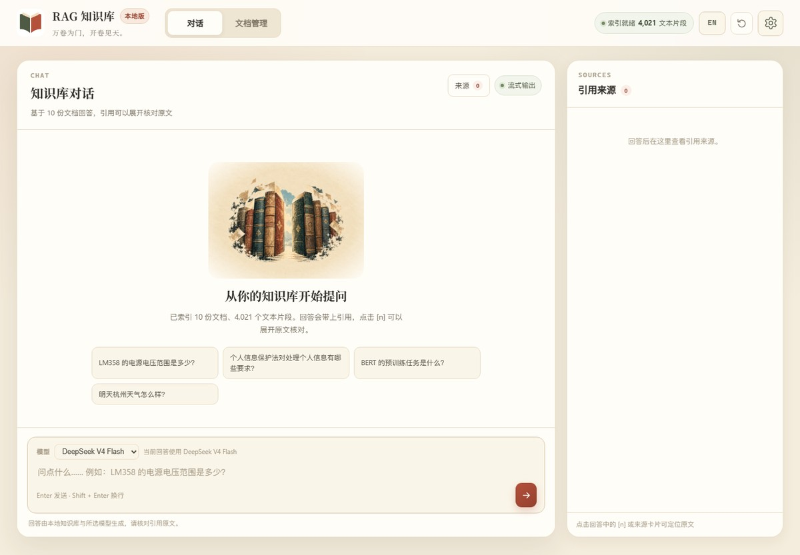
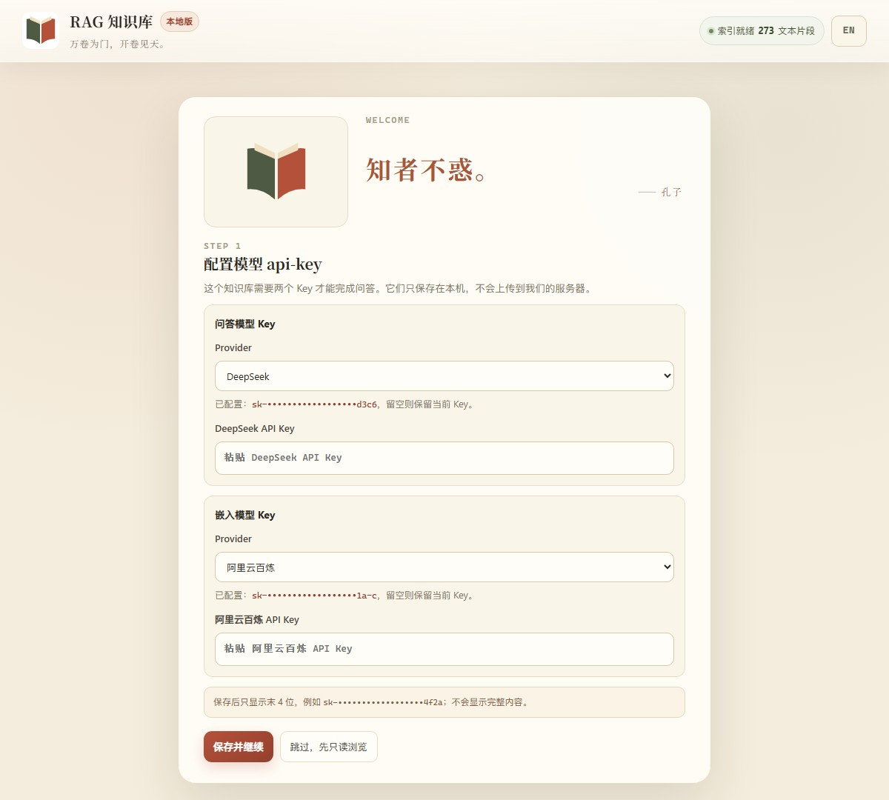

# RAG 知识库

### 把散落的文档，变成一个可以追问、可以核对的私人知识库

**万卷为门，开卷见天。**


一个面向个人和小团队的本地 RAG 知识库：导入 PDF / Word / TXT，提出问题，得到**带页码、可展开原文核对**的回答。

不训练模型，不把文档上传到第三方知识库；原文与向量留在本机，只把必要的文本片段发送给嵌入模型和生成模型。

---

## 界面预览

| 知识库对话 | 首次引导 |
|---|---|
|  |  |

> 截图使用本地空会话界面，不包含真实文档内容或 API Key。

---

## 为什么做这个项目

很多“个人知识库”最后会变成两件事：

- 一个只会把文档丢给大模型、回答无法核对的聊天框；
- 一个需要把资料上传到别人服务器的 SaaS。

这个项目想保留更朴素的东西：

- **回答必须能回到原文**：每条结论尽量标 `[n]`，右侧可看到文件名、页码、相关度和原文片段；
- **资料默认留在本机**：Chroma 向量库、上传文件、会话历史都在本地；
- **密钥不回传浏览器**：Key 通过 Windows DPAPI 加密保存，页面只显示掩码；
- **追问能接得上**：最近 5 轮对话 + 查询改写，让“那它的消融实验呢？”变成可检索的独立问题。

---

## 核心能力

| 能力 | 说明 |
|---|---|
| 多格式导入 | PDF / DOCX / TXT；保留页码、表格结构与来源元数据 |
| 向量检索 | Qwen `text-embedding-v4`，1024 维，Chroma cosine Top-K；低于 `MIN_SCORE`（默认 0.25）的片段不进入上下文 |
| 带出处回答 | 回答标注 `[n] 文件名 · 第 x 页`，来源面板可展开原文 |
| 防幻觉兜底 | 没有可用上下文或没有有效引用时，返回“知识库中没有相关信息。”；问候/闲聊则暖心回应且不标引用 |
| 多轮追问 | 内存保留最近 5 轮，追问先改写为独立查询再检索 |
| 文档管理 | 上传 job、进度轮询、软删除、恢复、彻底删除、全量重建 |
| Key 设置 | 首次引导 / 设置页保存、测试连接、清除；DPAPI 本机加密 |
| 中英界面 | 一键切换中文 / English；模型名和原文保持原语言 |

---

## 它是怎么工作的

```text
PDF / DOCX / TXT
      │
      ▼
  解析 + 分块 ──► Qwen Embedding (1024d) ──► Chroma 本地向量库
                                                   │
问题 ──► 追问改写 ──► Top-K 检索 ──► 上下文 + 历史 ──► DeepSeek
                                                   │
                                                   ▼
                                      带 [n] 引用的回答 + 来源面板
```

关键取舍：

- **检索优先于生成**：先把原文找对，再让模型组织语言；
- **引用优先于流畅**：没有有效引用的回答不当作知识库答案展示；
- **本地优先于云服务**：V1 只监听 `127.0.0.1`，不做公网部署；
- **可替换边界**：`SecretProvider`、`RequestContext` 等边界已为服务器化预留。

---

## 快速开始

### 环境要求

- Windows 10/11（V1 的 DPAPI Key 存储依赖 Windows）
- Python 3.11+
- 一个 DeepSeek API Key
- 一个阿里云百炼（DashScope）API Key

### 1. 安装

```powershell
git clone https://github.com/TSMczj/RAG_konwledge_base_system.git
cd RAG_konwledge_base_system

python -m venv .venv
.venv\Scripts\python.exe -m pip install -r requirements.txt

Copy-Item .env.example .env
# 按需修改 .env 中的模型名、检索参数、路径
```

### 2. 启动

```powershell
# Windows：双击 start.cmd，或执行
.\start.cmd

# 或者手动
.venv\Scripts\python.exe -m app.main
```

打开 <http://127.0.0.1:8000/>，按首次引导填入两个 Key 即可。

> 不想把 Key 存在本机？也可以改用系统环境变量 `DEEPSEEK_API_KEY` / `DASHSCOPE_API_KEY`，环境变量优先。  
> 完整配置、CLI 建库、故障排查见 [开发文档](PROJECT.md)。

### 3. 导入文档

- 在「文档管理」页上传 PDF / DOCX / TXT；
- 等待 job 状态变为“已入库”；
- 回到「对话」页提问。

也可以使用 CLI：

```powershell
.venv\Scripts\python.exe scripts\build_index.py
.venv\Scripts\python.exe scripts\ask.py "LM358 的电源电压范围是多少？"
```

---

## 技术栈

| 层 | 选型 |
|---|---|
| 编排 | LangChain |
| Web | FastAPI + Uvicorn + Jinja2 + 原生 JS |
| 向量库 | Chroma（本地持久化，cosine） |
| 嵌入 | 阿里云百炼 `text-embedding-v4`（1024 维） |
| 生成 | DeepSeek `deepseek-v4-flash` |
| 解析 | PyMuPDF + pdfplumber（PDF）、python-docx（Word） |
| 配置 / 日志 | pydantic-settings / loguru |
| 测试 | pytest（147 项） |

---

## 项目结构

```text
RAG_konwledge_base_system/
├── app/                 # FastAPI、核心 RAG、文档任务、设置 API
│   ├── api/             # chat / documents / index / settings / health
│   ├── core/            # loader / splitter / embedder / retriever / prompt / llm / qa / rewriter
│   ├── services/        # 文档任务、job、多轮会话
│   ├── static/          # 定稿前端资源
│   └── local_secrets.py # Windows DPAPI Key 存储
├── templates/           # Jinja2 页面
├── docs/                # 需求、架构、API 契约、问题排查、V1 问题收集
├── tests/               # pytest
├── scripts/             # 建库 / 问答 / 评估 / 自检
├── start.cmd            # Windows 一键启动
├── start.sh             # Git Bash / Linux / macOS
└── requirements.txt
```

---

## 文档

| 文档 | 内容 |
|---|---|
| [开发文档](PROJECT.md) | 环境、安装、CLI、开发说明 |
| [需求文档](docs/RAG需求文档-v1.0.md) | 产品范围、FR/NFR、A1–A10 验收 |
| [架构演进](docs/架构演进设计.md) | 本地优先、密钥、租户、服务器化边界 |
| [API 契约](docs/API契约-v1.0.md) | SSE、上传 job、删除、设置 Key、错误结构 |
| [任务清单](docs/RAG开发任务清单-v1.0.md) | 任务分解、依赖、完成状态 |
| [V1 问题与优化收集](docs/V1问题与优化收集.md) | 使用问题、优化想法、V2 候选 |

---

## V1 的边界

- **单用户、本地运行**：没有登录，也不监听公网；适合个人电脑或可信内网单机。
- **依赖云端模型**：嵌入和生成仍会调用 DashScope / DeepSeek；不是完全离线方案。
- **会话在内存里**：重启服务会清空最近 5 轮历史。
- **图片不入库**：V1 只索引文本与表格，PDF 里的图片和扫描页不参与检索，也没有 OCR。
- **格式边界**：V1 只支持 PDF / DOCX / TXT；Markdown、HTML、独立图片和扫描件尚未接入。
- **全量重建成本较高**：会重新消耗嵌入额度；V1 不提供取消/断点。重建会先算完向量再替换，失败时旧索引保持不变。
- **库外问题也会调用生成模型**：为区分闲聊与知识问题，没有检索结果时仍会请求一次 DeepSeek；引用兜底保证不展示无出处的知识回答。
- **模型选择器目前只实际启用 DeepSeek**：OpenAI / Anthropic 是 V2 的多模型规划。

这些不是“忽略的问题”，而是 V1 明确的范围。后续会按 [V1 问题与优化收集](docs/V1问题与优化收集.md) 转成 V2 需求。

---

## Roadmap

- **V2 · 多模型**：Provider 注册表，接入 OpenAI-compatible、Anthropic、GLM、MiMo；聊天页按回答记录模型。
- **V2 · 多格式与多模态文档**：Markdown / README / HTML 与章节级引用；扫描 PDF、独立图片（MinerU + DeepSeek Flash Vision）。
- **V2 · 检索质量**：BM25 + dense 混合、rerank、contextual chunking，面向大语料。
- **V2 · 评估与规模**：多格式 golden set、引用支持度/拒答评估；按阈值评估 pgvector / Qdrant。
- **V2 · 会话持久化**：SQLite 保存历史，重启后可继续追问。
- **V2 · 任务可靠性**：job 持久化、取消、失败重试与断点。
- **V2 · 工程规范**：统一错误结构 / `X-Request-ID`，稳定 `document_id`。
- **V2 · 服务器化**：登录、租户隔离、每用户密钥库。

---

## 状态

V1 已完成并通过 M1–M4 验收：本地索引、检索生成、Web 三页、多轮对话、真实 Key 闭环、A1–A10 全局验收。

如果这个项目对你有帮助，欢迎从 [开发文档](PROJECT.md) 开始；也欢迎把你使用 V1 时遇到的问题记录到 [问题收集](docs/V1问题与优化收集.md)。
