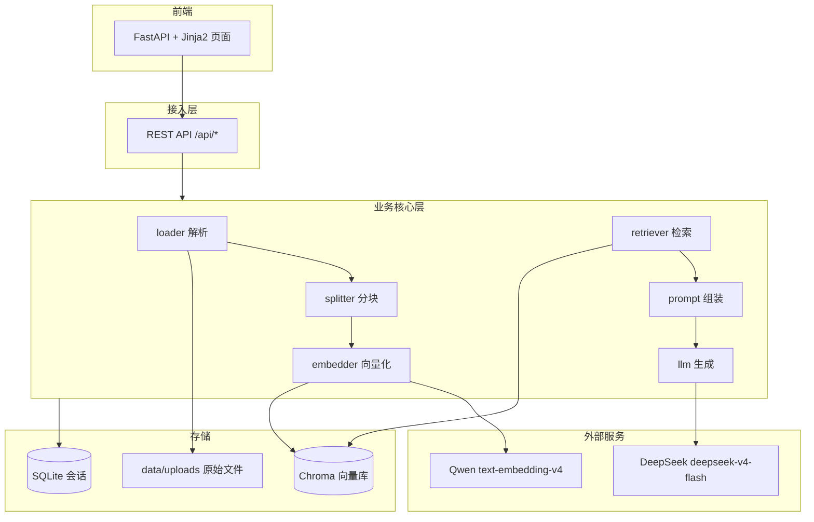

# RAG 本地知识库问答系统 · 需求文档

| 项目       | 内容              |
| -------- | --------------- |
| **文档版本** | v1.0            |
| **创建日期** | 2026-10-13      |
| **文档状态** | 待评审             |
| **目标读者** | 开发者本人（单用户）      |
| **项目代号** | `local-rag`     |
| **部署形态** | 本地运行，不上线、不对公网暴露 |

> **一句话目标**：在本地用 LangChain 搭一套 RAG 问答系统——把 PDF / Word / TXT 导入知识库，提问时用向量检索召回原文片段，交给大模型生成**带出处**的回答，并通过浏览器页面使用。

---

## 0. 文档使用说明

- 需求用 **FR-xx**（功能）与 **NFR-xx**（非功能）编号，便于后续逐条对账。
- 每条需求都带 **验收标准**，做到"可量化、可验证"。
- 优先级采用 MoSCoW：**M**=必须有、**S**=应该有、**C**=可以有、**W**=V1 不做。
- 文中所有参数默认值都标注为「可调」，并给出调整方向。

---

## 1. 项目概述

### 1.1 背景

本人（AI 方向研究生）日常积累了大量论文、教材与笔记（PDF / Word / TXT）。目前靠人工翻阅与全文搜索定位信息，效率低，且无法回答"跨文档聚合"类问题（如"这几篇论文分别用了什么损失函数"）。需要一个私有、可离线留存知识、按需调用云端模型的问答工具。

### 1.2 核心目标（可量化）

| 编号     | 目标         | 量化验收指标                                                    |
| ------ | ---------- | --------------------------------------------------------- |
| **G1** | 文档可顺利导入并检索 | 支持 `.pdf` / `.docx` / `.txt`；随机 10 份文档解析成功率 **≥ 95%**     |
| **G2** | 检索结果准确     | 自建 20 条测试问答，**Top-5 召回命中率 ≥ 85%**                         |
| **G3** | 回答可溯源      | **100%** 的回答附带来源（文件名 + 页码）；抽查 10 条，**可溯源率 100%**          |
| **G4** | 响应速度可接受    | 检索 **P95 < 1s**；**首字延迟 < 3s**；**单轮完整回答 < 15s**            |
| **G5** | 工程可复现      | 新环境 `pip install -r requirements.txt` + 一条命令启动；核心链路有自动化测试 |

### 1.3 非目标（V1 明确不做，Out of Scope）

| 项目                      | 说明                           |
| ----------------------- | ---------------------------- |
| 用户系统 / 登录 / 权限          | 单用户本地使用，不做鉴权                 |
| 公网部署 / 多租户 / 高可用        | 仅本机 `127.0.0.1` 访问           |
| 混合检索（BM25）+ 重排序（Rerank） | 列入 **V2 预留**，V1 不做           |
| 图片内容语义理解                | 图注文本会入库，但不做图像 OCR 语义问答       |
| 扫描件 OCR                 | V1 不处理纯扫描 PDF（如需，见 §8 风险 R1） |
| 文档在线编辑 / 协作             | 知识库只读+增删，不做编辑                |
| 模型微调 / 训练               | 仅调用现成 API                    |
| 高并发压测                   | 单用户，不做并发优化                   |

### 1.4 术语表

| 术语            | 含义                           |
| ------------- | ---------------------------- |
| **RAG**       | 检索增强生成。先检索相关文档片段，再让大模型基于片段作答 |
| **Chunk**     | 文档切分后的最小检索单元（文本块）            |
| **Embedding** | 把文本映射成高维向量的过程/结果，用于计算语义相似度   |
| **Top-K**     | 检索返回的相似块数量                   |
| **向量库**       | 存储向量并支持相似度检索的数据库，本项目用 Chroma |
| **溯源 / 引用**   | 回答中标注信息来自哪个文件的哪一页            |
| **查询改写**      | 多轮对话中，把"那它呢"这类指代提问补全为独立查询    |

---

## 2. 用户与场景

### 2.1 目标用户

- 单用户（本人），本地使用，具备 Python 基础，能自行配置 API Key。

### 2.2 用户故事（User Stories）

| 编号       | 用户故事                                     | 优先级 |
| -------- | ---------------------------------------- | --- |
| **US-1** | 作为使用者，我把一批 PDF 放进指定目录或上传，系统自动解析入库，无需手工整理 | M   |
| **US-2** | 我提问"这篇论文用了什么损失函数"，系统给出答案并标注来自哪个文件第几页     | M   |
| **US-3** | 我追问"那它的消融实验呢"，系统结合上下文继续回答，不需要我重复主语       | S   |
| **US-4** | 我发现某篇文档解析有误，可以单独删除并重新导入，不影响其他文档          | S   |
| **US-5** | 我想知道知识库里现在有哪些文档，能一眼看到列表                  | S   |
| **US-6** | 我暂时不想花钱，希望导入文档时能看到大概花了多少 token / 成本      | C   |

### 2.3 核心使用流程


---

## 3. 功能需求（Functional Requirements）

### 3.1 总览表

| 编号    | 功能模块     | 优先级 | 一句话说明                     |
| ----- | -------- | --- | ------------------------- |
| FR-01 | 文档摄入     | M   | 上传或目录批量导入 pdf/docx/txt    |
| FR-02 | 文档解析     | M   | 抽取正文，保留表格结构，记录页码          |
| FR-03 | 文本分块     | M   | 按语义边界切块，带重叠               |
| FR-04 | 向量化与入库   | M   | Qwen 嵌入 → Chroma 持久化，幂等去重 |
| FR-05 | 索引管理     | S   | 列表 / 按文件删除 / 全量重建         |
| FR-06 | 相似度检索    | M   | 问题向量化 → Top-K 召回          |
| FR-07 | 提示词组装    | M   | 约束+上下文+问题的模板化拼装           |
| FR-08 | 答案生成     | M   | DeepSeek 流式生成             |
| FR-09 | 来源引用（溯源） | M   | 回答标注 [n]，可查看原文块           |
| FR-10 | 多轮对话     | S   | 历史管理 + 查询改写               |
| FR-11 | Web 界面   | M   | 聊天页 + 文档管理页               |
| FR-12 | HTTP API | M   | REST 接口 + Swagger 文档      |

---

### FR-01 文档摄入　`M`

**描述**：支持两种导入方式——① Web 页面文件上传（单/多选）；② 指定本地目录扫描导入。

**规则**：

- 支持扩展名：`.pdf`、`.docx`、`.txt`（`.md` 可选，S）。
- 单文件大小上限：**50 MB**（可调）。
- 上传文件落盘到 `data/uploads/`，保留原始文件。

**验收标准**：

- [ ] 上传一个 50MB 以内 PDF，能成功进入解析流程并给出状态反馈。
- [ ] 目录导入时，非目标扩展名文件被跳过且不报错。

---

### FR-02 文档解析　`M`

**描述**：把文档抽取为纯文本，同时尽量保留结构与页码信息。

**技术规则**：

| 类型       | 首选方案                            | 说明                                    |
| -------- | ------------------------------- | ------------------------------------- |
| PDF（文本型） | `PyMuPDF` / `pypdf`             | 按页抽取文本，**记录页码**                       |
| PDF（含表格） | `pdfplumber` 抽表 → 转 Markdown 表格 | 表格尽量整体保留，避免被切碎                        |
| Word     | `python-docx` + `unstructured`  | 抽取段落、标题层级、表格                          |
| TXT      | 直接读取                            | 需做编码探测（`charset-normalizer`），默认 UTF-8 |

**约束与已知限制**：

- 数学公式：尽力保留 LaTeX 原文；**若 PDF 中公式为图片形式，V1 不做公式识别**，会丢失或转为空。
- 图注/标题：作为普通文本入库。
- 解析单文件失败**不得中断整批导入**，需记录失败清单。

**验收标准**：

- [ ] 随机抽 10 份文档，人工核对抽取文本，关键段落无成段缺失。
- [ ] 解析结果中每条文本块都能回溯到 `(文件名, 页码)`。
- [ ] 引入 1 个损坏文件，其余文件仍正常入库。

---

### FR-03 文本分块　`M`

**描述**：使用 `RecursiveCharacterTextSplitter`（LangChain）按语义边界切块。

**默认参数**（可调）：

| 参数              | 默认值                                         | 调整方向                        |
| --------------- | ------------------------------------------- | --------------------------- |
| `chunk_size`    | **500 字符**                                  | 语义碎 → 调大（600–800）；检索不准 → 调小 |
| `chunk_overlap` | **80 字符**（约 16%）                            | 边界丢信息 → 调大                  |
| 分隔符优先级          | `\n\n` → `\n` → `。` → `；` → `！` → `？` → `，` | 面向中文的降级切分                   |
| 表格块             | **不拆分**，整表成块                                | —                           |

**元数据要求**：每个 chunk 必须携带 `source_file`、`page`、`chunk_index`。

**验收标准**：

- [ ] 抽样 20 个 chunk，句子未被从中间截断（或由 overlap 覆盖）。
- [ ] 表格所在 chunk 未被切散。

---

### FR-04 向量化与入库　`M`

**描述**：调用 Qwen 嵌入模型将 chunk 转成向量，写入 Chroma 并持久化。

**技术规格**：

| 项目    | 值                                      |
| ----- | -------------------------------------- |
| 嵌入模型  | `text-embedding-v4`（阿里云百炼 / DashScope） |
| 向量维度  | **1024**（默认；可选 768/512 降本）             |
| 单条上限  | 8,192 token                            |
| 单次批量  | **≤ 10 条**（API 硬限制，需分批）                |
| 向量库   | Chroma，持久化目录 `data/chroma/`            |
| 相似度度量 | **cosine**                             |
| 幂等策略  | 以文件内容 SHA-256 判重，已入库文件重复导入时跳过          |

> ⚠️ **重要约束**：同一模型若中途更改维度，之前所有向量**无法与新向量比较**，必须整库重建。V1 固定 1024 维，不得随意改动。

**验收标准**：

- [ ] 入库 N 个 chunk 后，`collection.count() == N`。
- [ ] 同一文件二次导入，库内数量不增加（幂等生效）。

---

### FR-05 索引管理　`S`

**描述**：对知识库做基本运维。

**能力**：

- 列出已入库文档（文件名、块数、导入时间）。
- 按文件删除：删除该文件对应的**全部** chunk 向量。
- 全量重建索引（清空后重新解析入库）。

**验收标准**：

- [ ] 删除某文件后，检索结果中不再出现该文件任何片段。
- [ ] 重建后 `count()` 与重建前一致（相同输入下）。

---

### FR-06 相似度检索　`M`

**描述**：把用户问题向量化，在 Chroma 中做 Top-K 相似度检索。

**规则**：

- 问题侧向量化使用 `text_type="query"`（若模型支持查询/文档区分优化）。
- 默认 **K = 5**（可调 3–10）。
- 支持按元数据过滤（如限定某个文件/文档类型）—— 优先级 C。
- 检索结果包含：`chunk 文本`、`相似度分数`、`文件名`、`页码`。

**验收标准**：

- [ ] 返回条数 ≤ K，且按相似度降序排列。
- [ ] 检索 P95 < 1s（不含 LLM 生成）。

---

### FR-07 提示词组装　`M`

**描述**：把检索到的上下文与用户问题组装成提示词。

**模板结构**：

1. **System**：角色设定 + 硬约束——
   - 只依据提供的上下文回答；
   - 上下文不足以回答时，明确回复"知识库中没有相关信息"，**禁止编造**；
   - 必须标注引用编号 `[n]`。
2. **Context**：拼接 Top-K 块，每块前加编号 `[1] [2] …`，并附来源标注。
3. **Question**：用户问题（多轮场景为改写后的独立问题）。

**Token 控制**：上下文总量上限 **6,000 token**（可调）；超出时按相似度取 Top，丢弃尾部。

**验收标准**：

- [ ] 提示词中每个上下文块都有唯一编号，且能与来源元数据一一对应。
- [ ] 上下文超限时自动截断且不报错。

---

### FR-08 答案生成　`M`

**描述**：调用 DeepSeek 生成回答，**流式**返回前端。

**技术规格**：

| 项目            | 值                                  |
| ------------- | ---------------------------------- |
| 模型            | `deepseek-v4-flash`（经 OpenAI 兼容接口） |
| Base URL      | `https://api.deepseek.com`         |
| 上下文窗口         | 1M token（远超本项目需要）                  |
| `temperature` | **0.2**（可调 0.0–0.5，越低越稳）           |
| 输出方式          | 流式（SSE / chunked）                  |
| 无答案兜底         | 上下文不相关时回复固定话术，不瞎猜                  |

> ⚠️ **注意**：`deepseek-chat` / `deepseek-reasoner` 两个旧模型名已于 2026-07-24 弃用，请直接使用 `deepseek-v4-flash`（更强推理可用 `deepseek-v4-pro`）。

**验收标准**：

- [ ] 给定测试问题，答案为中文、条理清晰。
- [ ] 上下文完全无关时，明确回复"没有相关信息"而非编造。
- [ ] 前端可见流式打字效果。

---

### FR-09 来源引用 / 溯源　`M`

**描述**：回答中标注信息来源，用户可核对原文。

**规则**：

- 回答正文内联标注 `[1]`、`[2]`。
- 回答下方列出引用列表：`[n] 文件名 · 第 x 页`。
- 前端可展开查看该片段**原文**。

**验收标准**：

- [ ] 抽查 10 条回答，每条都能追溯到真实存在且**语义相关**的原文块（可溯源率 100%）。
- [ ] 引用列表中的文件名、页码与库内元数据一致。

---

### FR-10 多轮对话　`S`

**描述**：支持带上下文的多轮追问。

**规则**：

- 维护会话历史，默认保留最近 **5 轮**（可调）。
- **查询改写**：把含指代/省略的追问（如"那它的消融实验呢"）结合历史改写为独立查询后再检索 —— **此项是关键，否则追问检索必然失败**。
- 历史持久化：SQLite（`data/chat.db`）或内存（重启即清）—— 优先级 C。

**验收标准**：

- [ ] 连续 3 轮追问，第 3 轮能正确复用前文主语并检索到相关片段。
- [ ] 历史超过上限时自动丢弃最旧轮次，不报错。

---

### FR-11 Web 界面　`M`

**描述**：FastAPI + Jinja2 模板 + 原生 JS（可选 HTMX），单进程部署。

**页面**：

| 页面    | 路径           | 内容                     |
| ----- | ------------ | ---------------------- |
| 聊天页   | `/`          | 提问输入框、流式回答区、引用展示区、清空会话 |
| 文档管理页 | `/documents` | 上传控件、已入库文档列表、删除按钮、重建索引 |

**验收标准**：

- [ ] 浏览器打开 `http://127.0.0.1:8000` 可用。
- [ ] 聊天页可完成"提问 → 流式回答 → 看到引用"完整闭环。

---

### FR-12 HTTP API　`M`

**描述**：提供 REST 接口，并自动生成 Swagger 文档。

| 方法       | 路径                      | 说明        |
| -------- | ----------------------- | --------- |
| `POST`   | `/api/chat`             | 提问，返回流式回答 |
| `POST`   | `/api/documents/upload` | 上传文档      |
| `GET`    | `/api/documents`        | 文档列表      |
| `DELETE` | `/api/documents/{id}`   | 删除文档      |
| `POST`   | `/api/index/rebuild`    | 重建索引      |
| `GET`    | `/api/health`           | 健康检查      |

**验收标准**：

- [ ] `/docs` 可打开，所有接口可在 Swagger 中调通。

---

## 4. 非功能需求（Non-Functional Requirements）

### NFR-1 性能

| 指标                | 目标值          | 测量方式    |
| ----------------- | ------------ | ------- |
| 检索耗时（含 query 向量化） | P95 **< 1s** | 服务端日志打点 |
| 首字延迟（TTFT）        | **< 3s**     | 前端计时    |
| 单轮完整回答            | **< 15s**    | 前端计时    |
| 单文件索引（≤50 页 PDF）  | **< 60s**    | 服务端日志打点 |
| 内存占用（空闲）          | **< 1 GB**   | 任务管理器   |

> 数值基于：本地 Chroma + 新加坡/北京地域云 API。若网络到云端延迟高，可放宽。

### NFR-2 可靠性

- 所有云端 API 调用需有**超时**（连接 10s / 读取 60s）与**重试**（最多 3 次，指数退避）。
- 单文件解析失败不阻断整批导入，失败项进入错误清单并可重试。
- 向量库写入失败时，需保证不产生"半入库"脏数据（按文件原子提交）。

### NFR-3 可维护性

- 分层架构：`api`（路由）/ `core`（业务）/ `models`（数据结构）分离。
- 全量类型注解，关键函数有 docstring。
- 统一日志：`loguru`，输出到控制台 + `logs/`。
- 配置外置：所有可调项进 `.env`，代码不硬编码。

### NFR-4 安全与隐私

- API Key 仅存于 `.env`，**禁止写入代码或提交仓库**（`.gitignore` 必须包含 `.env`）。
- 服务仅绑定 `127.0.0.1`，不监听 `0.0.0.0`。
- 数据流向说明：文档原文留在本机；仅 **chunk 文本片段**会发送至 Qwen（嵌入）和 DeepSeek（生成）——需使用者知情。

### NFR-5 成本（估算，供预算参考）

| 环节        | 假设                                      | 成本                                                    |
| --------- | --------------------------------------- | ----------------------------------------------------- |
| 首次建库（嵌入）  | 100 文档 × 20 块 × ~400 token ≈ 80 万 token | `text-embedding-v4` $0.07/百万 → \*\*≈ $0.06\*\*        |
| 单次问答（生成）  | 输入 ~3,000 token，输出 ~400 token           | `deepseek-v4-flash` $0.14/$0.28 每百万 → **≈ $0.0005/次** |
| 1,000 次问答 | —                                       | **≈ $0.5**                                            |

> 结论：小规模自用成本极低，**瓶颈不在钱，在解析质量与检索准确率**。

### NFR-6 可复现性

- `requirements.txt`（或 `pyproject.toml`）锁定版本。
- `.env.example` 提供配置模板。
- `README.md` 含：环境要求、安装、配置、启动、常见问题。
- 提供一键启动脚本（`start.ps1` / `start.sh`）。

---

## 5. 技术方案

### 5.1 架构分层



### 5.2 技术栈

| 层       | 选型                                   | 理由                                      | 备选                    |
| ------- | ------------------------------------ | --------------------------------------- | --------------------- |
| 编排框架    | **LangChain**                        | 你指定；生态成熟，Loader/Splitter/Retriever 开箱即用 | LlamaIndex            |
| Web 框架  | **FastAPI + Uvicorn**                | 你指定；异步、自带 Swagger                       | Flask                 |
| 模板      | **Jinja2 + 原生 JS/HTMX**              | 轻量够用                                    | Vue/React（过重）         |
| 向量库     | **Chroma**                           | 纯本地、零运维、自带元数据过滤与持久化                     | FAISS / Qdrant        |
| 嵌入模型    | **Qwen `text-embedding-v4`（1024 维）** | 中文强、便宜、国际站可用                            | BGE-m3（本地）            |
| 生成模型    | **DeepSeek `deepseek-v4-flash`**     | 性价比极高、中文好、OpenAI 兼容                     | deepseek-v4-pro       |
| PDF 解析  | **PyMuPDF + pdfplumber**             | 文本+表格兼顾、速度快                             | unstructured / marker |
| Word 解析 | **python-docx + unstructured**       | 结构与表格支持                                 | docx2txt              |
| 日志      | **loguru**                           | 开箱即用                                    | logging               |
| 配置      | **pydantic-settings**                | 类型安全、`.env` 友好                          | python-dotenv         |

> **版本策略**：以上均使用**当前稳定版并锁定版本号**（写入 `requirements.txt`），不追逐最新大版本，避免破坏性变更。


### 5.3 关键参数默认值汇总（全部可调）

| 参数                     | 默认                  | 位置                  |
| ---------------------- | ------------------- | ------------------- |
| `CHUNK_SIZE`           | 500 字符              | `.env`              |
| `CHUNK_OVERLAP`        | 80 字符               | `.env`              |
| `EMBEDDING_MODEL`      | `text-embedding-v4` | `.env`              |
| `EMBEDDING_DIM`        | 1024                | `.env`（**改动需整库重建**） |
| `EMBEDDING_BATCH_SIZE` | 10                  | `.env`（API 上限）      |
| `TOP_K`                | 5                   | `.env`              |
| `MAX_CONTEXT_TOKENS`   | 6000                | `.env`              |
| `LLM_MODEL`            | `deepseek-v4-flash` | `.env`              |
| `TEMPERATURE`          | 0.2                 | `.env`              |
| `MAX_HISTORY_TURNS`    | 5                   | `.env`              |
| `CHROMA_DIR`           | `./data/chroma`     | `.env`              |

### 5.4 建议目录结构

```
local-rag/
├── app/
│   ├── main.py                 # FastAPI 入口，挂载路由与模板
│   ├── config.py               # pydantic-settings 读取 .env
│   ├── api/
│   │   ├── chat.py             # /api/chat
│   │   └── documents.py        # /api/documents*、/api/index/rebuild
│   ├── core/
│   │   ├── loader.py           # 文档解析（pdf/docx/txt）
│   │   ├── splitter.py         # 分块
│   │   ├── embedder.py         # Qwen 向量化（含分批）
│   │   ├── vectorstore.py      # Chroma 封装（增删查）
│   │   ├── retriever.py        # Top-K 检索
│   │   ├── rewriter.py         # 多轮查询改写
│   │   ├── prompt.py           # 提示词模板
│   │   └── llm.py              # DeepSeek 调用（流式）
│   ├── models/
│   │   └── schemas.py          # Pydantic 请求/响应模型
│   ├── templates/
│   │   ├── base.html
│   │   ├── index.html          # 聊天页
│   │   └── documents.html      # 文档管理页
│   └── static/                 # css/js
├── data/
│   ├── uploads/                # 原始文档
│   ├── chroma/                 # 向量库持久化
│   └── chat.db                 # 会话历史（可选）
├── logs/
├── tests/
│   ├── test_loader.py
│   ├── test_splitter.py
│   ├── test_retriever.py
│   └── test_api.py
├── .env.example
├── .gitignore                  # 必须含 .env、data/、logs/
├── requirements.txt
├── README.md
└── start.ps1 / start.sh
```

---

## 6. 配置与数据约定

### 6.1 环境变量（`.env.example`）

```dotenv
# ===== 云端模型凭证 =====
DEEPSEEK_API_KEY=sk-xxxxxxxx
DEEPSEEK_BASE_URL=https://api.deepseek.com

DASHSCOPE_API_KEY=sk-xxxxxxxx
# 新加坡地域（按实际业务空间 ID 替换 {WorkspaceId}）
DASHSCOPE_BASE_URL=https://{WorkspaceId}.ap-southeast-1.maas.aliyuncs.com/compatible-mode/v1

# ===== 模型与检索参数 =====
LLM_MODEL=deepseek-v4-flash
EMBEDDING_MODEL=text-embedding-v4
EMBEDDING_DIM=1024
EMBEDDING_BATCH_SIZE=10
TOP_K=5
MAX_CONTEXT_TOKENS=6000
TEMPERATURE=0.2
MAX_HISTORY_TURNS=5

# ===== 分块参数 =====
CHUNK_SIZE=500
CHUNK_OVERLAP=80

# ===== 存储路径 =====
CHROMA_DIR=./data/chroma
UPLOAD_DIR=./data/uploads
COLLECTION_NAME=knowledge_base
```

### 6.2 向量元数据 Schema（Chroma metadata）

| 字段            | 类型  | 说明                               |
| ------------- | --- | -------------------------------- |
| `source_file` | str | 原始文件名                            |
| `file_path`   | str | 原始文件路径                           |
| `file_hash`   | str | 内容 SHA-256，用于幂等判重                |
| `doc_type`    | str | `pdf` / `docx` / `txt`           |
| `page`        | int | 页码（txt 为 0）                      |
| `chunk_index` | int | 该文件内块序号                          |
| `chunk_id`    | str | `{file_hash}-{chunk_index}` 全局唯一 |
| `created_at`  | str | ISO8601 导入时间                     |

> 检索时交给 LLM 的**上下文文本**与**来源元数据**分离存放：文本入 `documents`，元数据入 `metadatas`，便于引用展示。

---

## 7. 验收标准与测试方案

### 7.1 验收清单（Definition of Done）

| 编号  | 验收项   | 判定方法          | 通过线                    |
| --- | ----- | ------------- | ---------------------- |
| A1  | 文档导入  | 导入 10 份混合格式文档 | 成功率 ≥ 95%              |
| A2  | 检索准确率 | 20 条测试问答，人工标注 | Top-5 命中率 ≥ 85%        |
| A3  | 溯源准确性 | 抽查 10 条回答     | 可溯源率 100%              |
| A4  | 响应时间  | 20 次提问计时      | 检索 P95<1s、首字<3s、整轮<15s |
| A5  | 多轮可用  | 连续 3 轮追问      | 第 3 轮正确复用上下文           |
| A6  | 兜底防幻觉 | 提问库外问题        | 回复"无相关信息"，不编造          |
| A7  | 幂等    | 同一文件导入两次      | 库内块数不变                 |
| A8  | 删除生效  | 删除文件后检索       | 不再命中该文件                |
| A9  | 工程规范  | 检查仓库          | 有一键启动、测试可跑、README 完整   |
| A10 | 成本可控  | 记录 API 用量     | 单次问答成本 < $0.001        |

### 7.2 测试集构建方法（用于 A2）

1. 从已入库文档中**人工挑选 20 个可明确回答的问题**。
2. 每个问题标注对应的**正确来源文件 + 页码**（作为 ground truth）。
3. 跑一遍检索，统计正确来源是否落在 Top-5 内。
4. 命中数 / 20 = 命中率，需 ≥ 85%（即至少 17 条命中）。
5. 该测试集固化为 `tests/eval_questions.json`，每次改动检索参数后回归。

### 7.3 自动化测试范围

- `test_loader.py`：三种格式各一份样例，验证解析输出非空且含页码。
- `test_splitter.py`：验证块大小在预期区间、overlap 生效、表格块不被切。
- `test_retriever.py`：mock 嵌入接口，验证 Top-K 数量与排序。
- `test_api.py`：用 `TestClient` 打通 `/api/health`、`/api/documents` 等接口。

---

## 8. 风险与对策

| 编号     | 风险               | 影响       | 对策                              |
| ------ | ---------------- | -------- | ------------------------------- |
| **R1** | PDF 为扫描件/图片，无文本层 | 该文档入库为空  | 导入前检测文本层密度并告警；V2 再接 OCR         |
| **R2** | 表格/公式解析错乱        | 检索到残缺内容  | 表格走 pdfplumber 单独抽取；公式明确标注为已知限制 |
| **R3** | 中文分块边界切坏句子       | 检索片段语义破碎 | 中文标点作为分隔符 + 80 字符重叠             |
| **R4** | 追问检索失败（指代丢失）     | 多轮体验差    | 必做查询改写（FR-10）                   |
| **R5** | 云端 API 限流/超时     | 导入或问答中断  | 重试+退避+超时；批量导入分批限速               |
| **R6** | 模型幻觉             | 回答不可信    | 提示词强约束 + temperature 0.2 + 强制溯源 |
| **R7** | 中途改嵌入维度          | 全库向量失效   | V1 锁定 1024 维；改动前必须整库重建          |
| **R8** | API Key 泄漏       | 费用损失     | Key 仅存 `.env`，`.gitignore` 排除   |
| **R9** | 摘要式回答丢失细节        | 关键信息被略过  | 提示词要求"引用编号 + 忠实原文"              |

---

## 9. 里程碑（建议交付顺序）

| 阶段     | 目标                | 交付物                       | 依赖          |
| ------ | ----------------- | ------------------------- | ----------- |
| **M1** | 离线跑通「解析→分块→嵌入→入库」 | CLI 脚本 + Chroma 数据        | FR-01~04    |
| **M2** | 离线跑通「检索→组装→生成」    | CLI 问答脚本，能出带引用答案          | FR-06~09    |
| **M3** | Web 化             | FastAPI 服务 + 聊天页 + 管理页    | FR-11、FR-12 |
| **M4** | 多轮 + 验收           | 查询改写 + 测试集 + 全部 A1–A10 通过 | FR-10、§7    |

> 建议**每个里程碑都可独立运行、可演示**，避免"最后一刻才跑通"。

---

## 10. 待决事项（Open Questions）

| 编号 | 问题                                                  | 影响           | 建议                     |
| -- | --------------------------------------------------- | ------------ | ---------------------- |
| Q1 | 表格解析库最终选 `pdfplumber` 还是 `unstructured` / `marker`？ | 解析质量 vs 依赖重量 | M1 阶段用 3 份样例文档实测对比     |
| Q2 | 会话历史是否持久化（SQLite）还是仅内存？                             | 重启后历史是否保留    | 默认内存，需要则升 SQLite       |
| Q3 | 是否需要 Docker 化？                                      | 部署便利性        | 本地自用可先不做，README 写清依赖即可 |
| Q4 | 是否需要 V2 的混合检索 + Rerank？                             | 准确率上限        | 先按 V1 验收，命中率不达标再上      |
| Q5 | 是否需要「父文档-子块」检索（小块召回、大块喂给模型）？                        | 上下文完整性       | V2 候选                  |

---

## 附录 A：V1 → V2 演进方向（暂不实现）

1. **混合检索**：BM25 关键词 + 向量双路召回（`text-embedding-v4` 已支持稀疏向量）。
2. **重排序**：接入 Rerank 模型对 Top-20 精排取 Top-5。
3. **OCR**：扫描件接入 PaddleOCR。
4. **父文档检索**：小块召回、大块供给，兼顾准确率与上下文完整。
5. **多知识库**：按项目/课程分 collection。
6. **评测自动化**：RAGAS 等框架做忠实度/相关性打分。

---

*文档结束 · v1.0*
